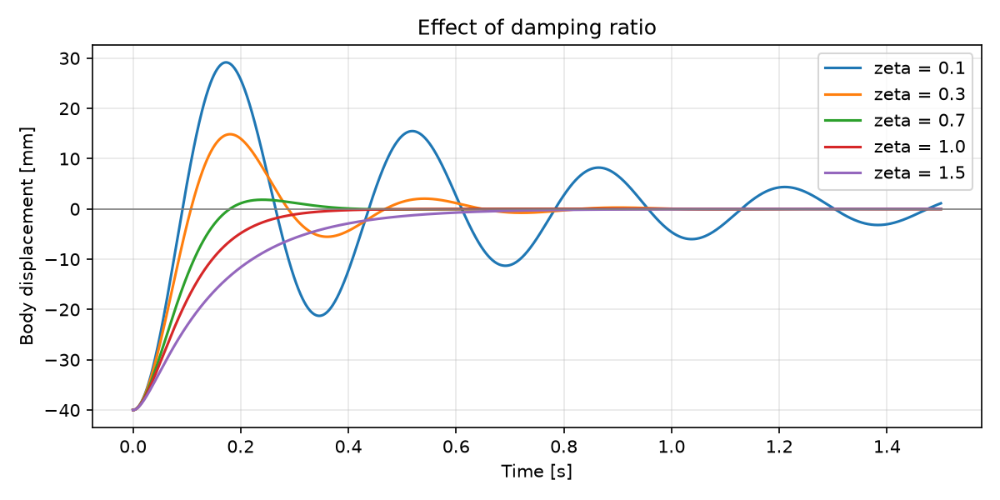

# Quarter-Car Suspension Model
Python simulation of one corner of a Formula Student quarter car, built step by step to understand ride frequency, damping and road inputs. Part of my self-directed vehicle dynamics study alongside my degree and my formula student suspension role. 

## Stage 1 - Free Vibration
A mass spring damper released from 20mm below rest.

- Corner mass 65kg, spring 20kN/m, damping ratio 0.3
- Hand calculation: natural frequency 2.79 Hz, damped 2.66 Hz
- Simulation period 0.376s -> 2.66 Hz, matching the hand calculation
 

**What I learned:** Damping doesn't paticularly change the bounce frequency but it controls how fast the bounce frequency dies away. Critical damping (zeta = 1) settles fastest with no overshoot, but too much damping is sluggish.
